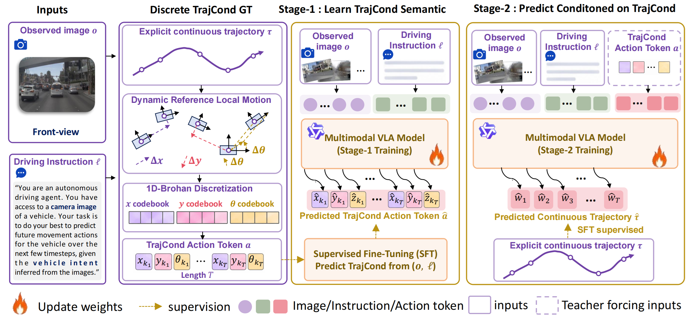

# TrajCond-VLA

**Learn a Trajectory-Geometric Condition from Reasoning for Autonomous Driving VLA**

 [](LICENSE)

> TrajCond-VLA connects driving reasoning with trajectory geometry through a discrete action condition, *TrajCond*.
> A two-stage learning pipeline first teaches trajectory-action semantics, then predicts continuous trajectories conditioned on the learned actions and reasoning.

## Overview



TrajCond-VLA represents local differential motions as action tokens, providing a trajectory-geometric condition for continuous trajectory prediction.

The same VLA model is trained in two supervised stages:

- **Stage 1: TrajCond semantics learning** — Predict driving reasoning and discrete action tokens from the front-view image, high-level intent, and ego history
- **Stage 2: TrajCond-conditioned planning** — Initialize from Stage 1 and generate discrete actions, driving reasoning, and the final continuous trajectory in the order `AT → CoT → PT`

At inference, TrajCond-VLA generates the action condition and continuous trajectory in one autoregressive pass.

The project supports KMeans, KDisks, and per-axis 1D-Brohan action representations. The main Brohan setting uses 768 action tokens, with 256 tokens for each of `dx`, `dy`, and `dyaw`. NAVSIM trajectories consist of eight future poses over four seconds at 2 Hz.

## Release

- [x] KMeans, KDisks, and Brohan codebook construction
- [x] Configurable Data Engine with six two-stage dataset pipelines
- [x] LLaMA-Factory SFT and DeepSpeed configurations
- [x] GRPO reference — available at [Curious-VLA](https://github.com/Mashiroln/curious_vla)
- [x] Annotations and datasets — available at [Google Drive](https://drive.google.com/drive/folders/1T5kgpoeLcoKxoguCWJprfR3JP3WVrEt6?usp=sharing)

## Codebooks and Data Engine

The `codebook/` directory contains motion extraction and codebook construction for all three action representations:

```bash
python codebook/build_codebook_from_gt.py --method brohan --size 768
python codebook/build_codebook_from_gt.py --method kmeans --size 768
python codebook/build_codebook_from_gt.py --method kdisks --size 768
```

`--size` specifies the total number of action tokens. The Brohan builder uses inclusive min/max grids; each build also saves `action_variances.json` beside the codebook.

See the full [codebook documentation](codebook/README.md).

The `data_engine/` directory extends the configurable architecture of [DriveTeach-VLA](https://github.com/ShivaTeam/DriveTeach-VLA) to construct TrajCond-VLA training datasets:

- **Extract** — NAVSIM raw data → structured intermediate representation (SampleIR)
- **Enrich** — Pluggable enricher chain: image path substitution, CoT merging, action encoding, error filtering, and trajectory normalization
- **Render** — Two-stage PromptBuilders produce LLaMA-Factory-compatible training data

Six built-in pipelines:

| Representation | Stage 1 pipeline | Stage 2 pipeline | Actions per future step |
|----------------|------------------|------------------|-------------------------|
| KMeans | [navsim_kmeans_stage1](data_engine/configs/pipelines/navsim_kmeans_stage1.yaml) | [navsim_kmeans_stage2](data_engine/configs/pipelines/navsim_kmeans_stage2.yaml) | One joint token |
| KDisks | [navsim_kdisks_stage1](data_engine/configs/pipelines/navsim_kdisks_stage1.yaml) | [navsim_kdisks_stage2](data_engine/configs/pipelines/navsim_kdisks_stage2.yaml) | One joint token |
| Brohan | [navsim_brohan_stage1](data_engine/configs/pipelines/navsim_brohan_stage1.yaml) | [navsim_brohan_stage2](data_engine/configs/pipelines/navsim_brohan_stage2.yaml) | Three per-axis tokens |

Both stages encode NAVSIM original future poses into action tokens and use the same external CoT annotations: `critical_objects`, `meta_behaviour`, and `explanation`.

Configure the NAVSIM paths in `data_engine/configs/datasets/navsim.yaml` and the CoT, codebook, and image paths in the selected pipeline before running:

```bash
pip install -r data_engine/requirements.txt
# Install NAVSIM v2 following its official instructions.
python data_engine/main.py --config data_engine/configs/pipelines/navsim_brohan_stage1.yaml --check-config
python data_engine/main.py --config data_engine/configs/pipelines/navsim_brohan_stage1.yaml --num-workers 8
python data_engine/main.py --config data_engine/configs/pipelines/navsim_brohan_stage2.yaml --num-workers 8
```

Each pipeline independently filters the worst action reconstructions, controlled by `drop_fraction` (default: `0.01`; set to `0` to disable). Datasets are saved as ShareGPT JSON arrays under `data_engine/output/`.

See the full [data engine documentation](data_engine/README.md), [configuration guide](data_engine/docs/CONFIG.md), and [path reference](data_engine/docs/PATHS.md).

## Training

The `sft/` directory contains the two-stage SFT configurations for LLaMA-Factory. The default model is Qwen3-VL-4B, with full SFT for three epochs per stage, a learning rate of `4e-5`, and 16 GPUs with two samples per GPU and accumulation 1, giving a global batch size of 32.

Before SFT, add the action vocabulary and four special tokens (`<thinking>`, `</thinking>`, `<answer>`, `</answer>`), then save the model, tokenizer, and multimodal processor. `--num-action-tokens` counts only action tokens:

```bash
python sft/extend_action_vocab.py \
  --base-model /path/to/Qwen3-VL-4B-Instruct \
  --output-dir models/Qwen3-VL-4B-Instruct-768action \
  --num-action-tokens 768

FORCE_TORCHRUN=1 NPROC_PER_NODE=16 llamafactory-cli train sft/configs/navsim_brohan_stage1.yaml
FORCE_TORCHRUN=1 NPROC_PER_NODE=16 llamafactory-cli train sft/configs/navsim_brohan_stage2.yaml
```

The six training YAMLs use official LLaMA-Factory fields, the `qwen3_vl` template, and a flat configuration format. Stage 1 loads the expanded base model; Stage 2 loads the Stage-1 checkpoint. Training uses the [DeepSpeed ZeRO-2 configuration](deepspeed/ds_z2_config.json). See the SFT guide for template selection and training configuration.

Reinforcement fine-tuning follows [Curious-VLA](https://github.com/Mashiroln/curious_vla). Use its [GRPO workflow](https://github.com/Mashiroln/curious_vla/blob/main/docs/train_grpo.md) with the Stage-2 checkpoint, adapting the rollout prompts and reward trajectory parser to `AT → CoT → PT`.

See the full [SFT documentation](sft/README.md).

## Acknowledgements

This project is built upon [Qwen3-VL](https://github.com/QwenLM/Qwen3-VL), [NAVSIM](https://github.com/autonomousvision/navsim), [LLaMA-Factory](https://github.com/hiyouga/LLaMA-Factory), and [DriveTeach-VLA](https://github.com/ShivaTeam/DriveTeach-VLA).

Reinforcement learning design follows [Curious-VLA](https://github.com/Mashiroln/curious_vla).

We thank the open-source community for their contributions.

## License

This project is licensed under the [Apache 2.0 License](LICENSE).
